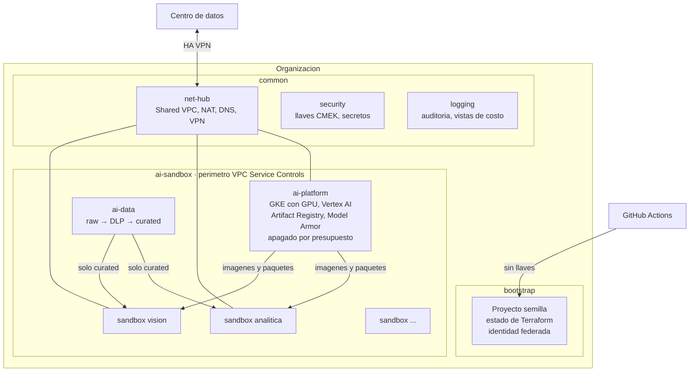

# Sandbox de IA en GCP con Terraform

Plataforma para que los equipos de una empresa experimenten con IA generativa y aprendizaje automatico en Google Cloud sin poner en riesgo los datos ni el presupuesto. Todo se despliega con Terraform, desde una organizacion vacia hasta el sandbox de cada equipo, y cada cambio pasa por un pull request.

Proyecto del Equipo 4 para el reto "Sandbox de IA en GCP con Terraform".

## Que nos diferencia

| Diferenciador | Que recibe el cliente | Donde vive |
|---|---|---|
| Plantillas por perfil y talla | Un equipo pide un sandbox con siete datos. El perfil (rag, finetuning, modelos-abiertos, ml-clasico, agentes) decide servicios y permisos. La talla (s, m, l) decide presupuesto y cuota de GPU. | `stages/5-sandboxes/profiles.yaml`, `modules/sandbox-factory` |
| Costo por equipo y por experimento | Vistas en BigQuery que reparten la factura por equipo, centro de costos y experimento, y una vista con el gasto que nadie etiqueto. | `modules/cost-guard/views.tf` |
| Cadena de suministro segura | Imagenes y paquetes solo desde repositorios internos, con escaneo de vulnerabilidades y Binary Authorization en el cluster. | `modules/mlops`, `modules/gke-gpu` |

Sobre esa base, el diseno incluye apagado automatico al agotar el presupuesto, GPU compartida y en Spot que escala a cero, perimetro de VPC Service Controls en dos pasos, llaves administradas por el cliente, lista de modelos permitidos, anonimizacion de datos antes de llegar a los equipos y un pipeline sin llaves.

## Arquitectura



## Estructura

```
stages/            Seis etapas que se aplican en orden
  0-bootstrap      Proyecto semilla, estado, cuentas por etapa, identidad federada
  1-org            Carpetas, proyectos comunes, politicas de organizacion, auditoria
  2-security       Llaves CMEK, secretos, perimetro de VPC Service Controls
  3-networks       Shared VPC, NAT, DNS privado, firewall, VPN, pruebas de conectividad
  4-ai-platform    Datos, GPU, Vertex AI, guardrails, cadena de suministro, costos
  5-sandboxes      Un sandbox por archivo en teams/, segun el catalogo profiles.yaml
modules/           Modulos reutilizables, uno por capacidad
functions/         Funcion de apagado por presupuesto
policies/          Reglas en Rego para solicitudes de sandbox y planes de Terraform
tests/             Pruebas del perimetro, de red y de la funcion
scripts/           Vencimientos y conversion del formulario de solicitud
docs/              Guia para equipos, runbooks y decisiones de diseno
```

Cada etapa lee las salidas de las anteriores desde el estado remoto y usa su propia cuenta de servicio con los permisos minimos para lo que crea.

## Como pide un sandbox un equipo

Un archivo en `stages/5-sandboxes/teams/`:

```yaml
name: vision
owner_group: gcp-vision@example.com
cost_center: cc-2210
expires: "2027-02-28"
profile: finetuning
size: m
subnet_index: 1
```

Tambien se puede pedir con el formulario "Solicitud de sandbox" en Issues, que genera el archivo y abre el pull request. Las reglas de `policies/sandbox` revisan la solicitud antes de cualquier plan: el responsable debe ser un grupo, la vigencia no puede superar 180 dias, el presupuesto tiene tope y la GPU H100 exige una aprobacion. Al aprobar el pull request, el pipeline crea el proyecto con su subred, su presupuesto, sus permisos y sus etiquetas.

Detalle en [docs/guia-equipos.md](docs/guia-equipos.md).

## Despliegue

Requisitos: una organizacion de Google Cloud, una cuenta de facturacion, Terraform 1.9 o posterior y una persona con permisos de administrador de la organizacion para el primer paso.

1. Aplicar `stages/0-bootstrap` a mano, una sola vez:

   ```bash
   cd stages/0-bootstrap
   terraform init
   terraform apply -var org_id=... -var billing_account=... -var prefix=acme -var github_repo=AckerSaldana/SandboxTerraform
   ```

   Despues, mover su estado al bucket que acaba de crear: quitar el comentario del bloque `backend "gcs"` en `versions.tf` y ejecutar `terraform init -migrate-state -backend-config="bucket=<tfstate_bucket>" -backend-config="prefix=0-bootstrap"`.

2. Registrar en GitHub (Settings, Secrets and variables, Actions, Variables) las salidas del paso anterior:

   | Variable | Valor |
   |---|---|
   | `WIF_PROVIDER` | salida `wif_provider` |
   | `TFSTATE_BUCKET` | salida `tfstate_bucket` |
   | `TF_SA_ORG`, `TF_SA_SECURITY`, `TF_SA_NETWORKS`, `TF_SA_AI_PLATFORM`, `TF_SA_SANDBOXES` | salida `stage_service_accounts` |
   | `ORG_ID`, `BILLING_ACCOUNT`, `PREFIX` | los mismos del paso 1 |
   | `PLATFORM_GROUP`, `DATA_OWNERS_GROUP` | grupos de Google de plataforma y de duenos de datos |

3. Ejecutar el flujo `terraform` sobre `main`. Aplica las etapas 1 a 5 en orden.

4. Tareas manuales que Terraform no cubre:
   * Cargar el secreto compartido de la VPN en Secret Manager (`vpn-shared-secret`).
   * Activar la exportacion detallada de facturacion a BigQuery y escribir la tabla en `stages/4-ai-platform/config.auto.tfvars`.
   * Generar y versionar los archivos `.terraform.lock.hcl` con `terraform init` en cada etapa.
   * Proteger la rama `main` y exigir la revision de los responsables de `CODEOWNERS`.

5. Pasar los interruptores de prueba a obligatorio cuando los registros lo permitan: `perimeter_enforced`, `binauthz_enforced` y `cost_guard_dry_run`. Procedimiento en [docs/runbooks.md](docs/runbooks.md).

Mientras `WIF_PROVIDER` no exista, el pipeline solo ejecuta los controles de calidad.

## Calidad

Cada pull request ejecuta:

| Control | Herramienta |
|---|---|
| Formato y validacion de las seis etapas | `terraform fmt`, `terraform validate` |
| Pruebas de la fabrica de sandboxes con proveedores simulados | `terraform test` |
| Buenas practicas de Terraform | tflint |
| Reglas de solicitudes y sus pruebas | conftest |
| Reglas sobre el plan: sin acceso publico, sin roles basicos, sin llaves, CMEK, etiquetas | conftest |
| Pruebas de la funcion de apagado | unittest |
| Analisis estatico de seguridad (informativo) | checkov |

Despues del despliegue: `tests/perimetro.sh` y `tests/red.sh`. Cada semana el pipeline compara el codigo con lo desplegado y cada dia revisa los sandboxes por vencer.

## Estado

El codigo esta validado contra el esquema del proveedor de Google 6.50 y sus pruebas pasan, pero todavia no se ha aplicado contra una organizacion real. Antes del primer despliegue hay que confirmar:

* Los nombres de las metricas de cuota de GPU (`gpu_quota_metrics`), por eso `enforce_gpu_quota` inicia en `false`.
* Los modelos vigentes en `allowed_models`.
* Que la cuenta de la etapa 5 puede asociar proyectos a la Shared VPC con el rol que recibe en la carpeta.
* La disponibilidad de GPU con inicio flexible y de Model Armor en la region elegida.

## Documentacion

* [Guia para equipos](docs/guia-equipos.md)
* [Runbooks](docs/runbooks.md)
* [Decisiones de diseno](docs/decisiones.md)
